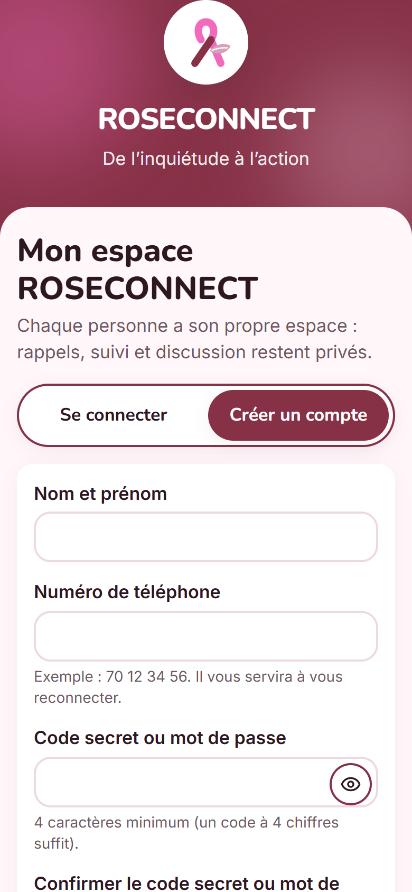
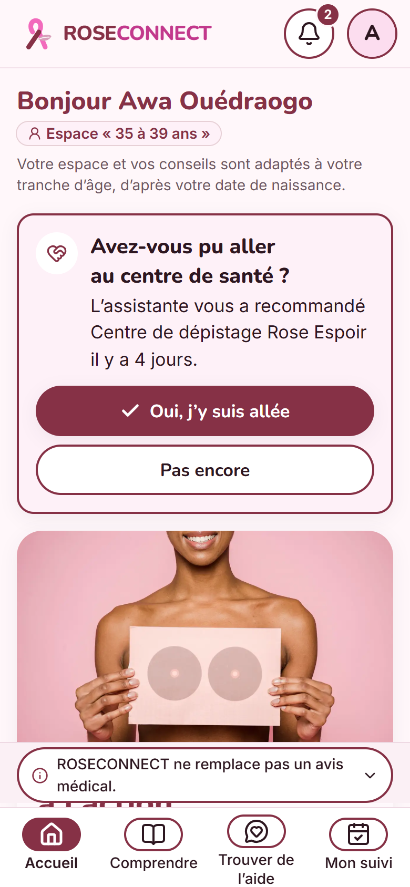
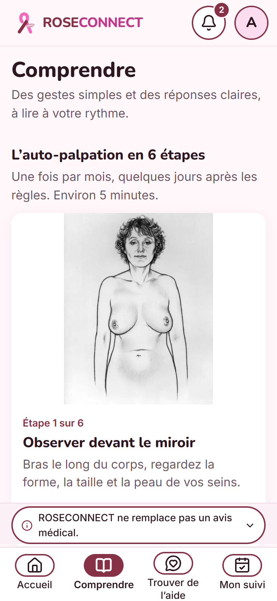
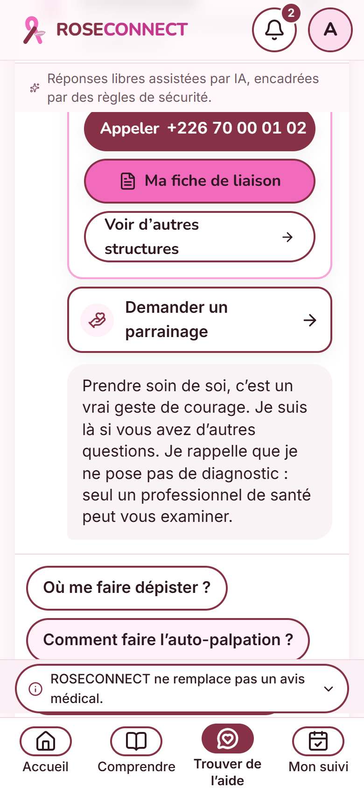
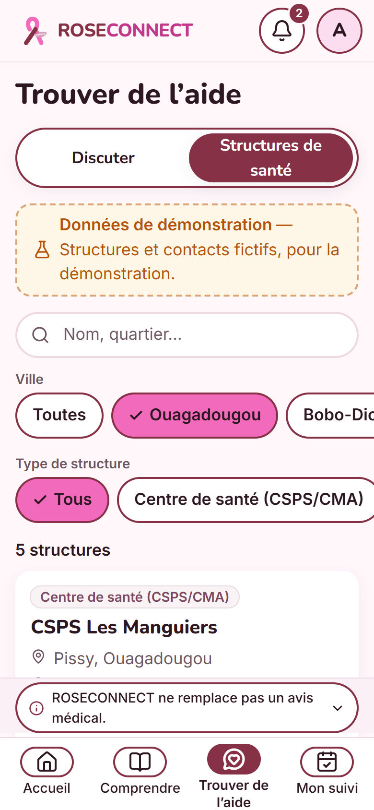
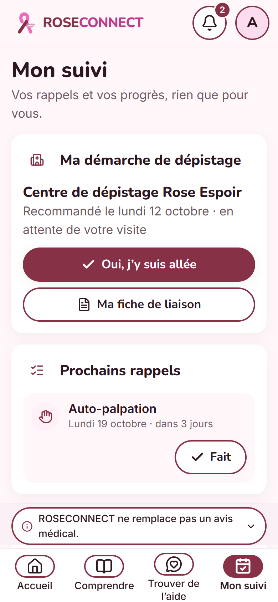
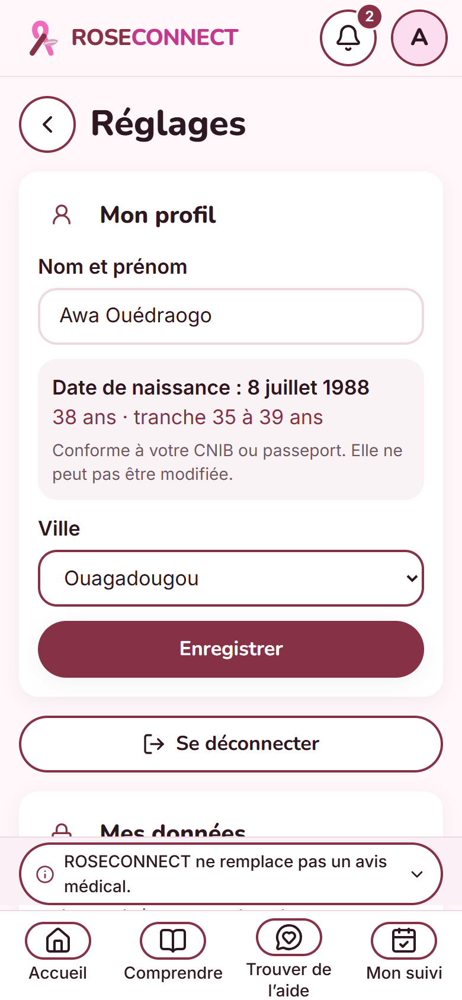
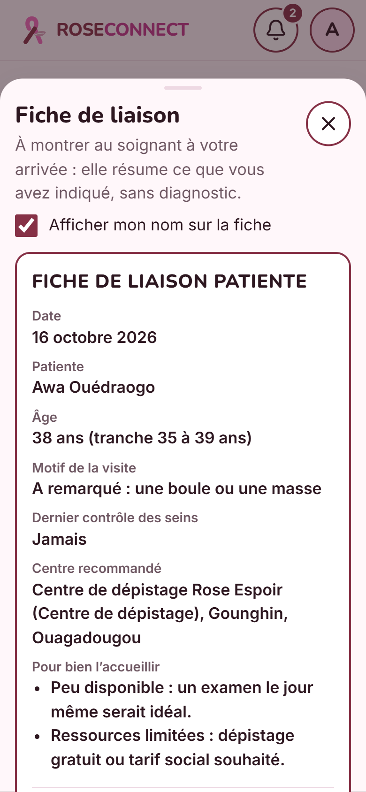
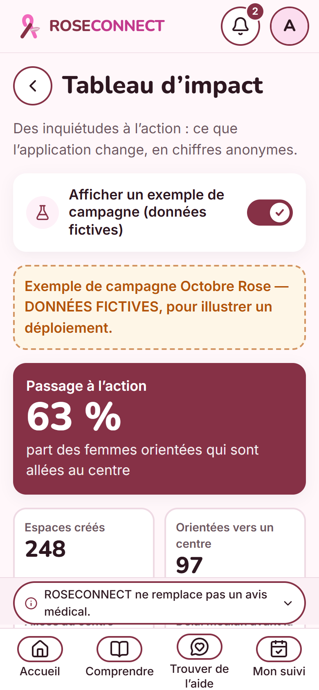

# ROSECONNECT — De l’inquiétude à l’action

Application web responsive (mobile d’abord, installable en PWA) de **sensibilisation, d’orientation et d’accompagnement face au cancer du sein**, conçue pour un hackathon Octobre Rose au Burkina Faso.

> ROSECONNECT ne remplace pas un avis médical. L’application informe et oriente. Elle ne pose **jamais** de diagnostic.
> Toutes les structures de santé et tous les contacts sont **fictifs** (données de démonstration).

| Connexion | Accueil | Comprendre | Assistante | Structures |
| --- | --- | --- | --- | --- |
|  |  |  |  |  |

| Mon suivi | Réglages | Fiche de liaison | Tableau d’impact |
| --- | --- | --- | --- |
|  |  |  |  |

## Fonctionnalités

- **Accueil** : slogan, repères de dépistage adaptés à l’âge (facultatif, stocké localement), prochaine action avec bouton « Fait », chiffre clé, carte « Bientôt : col de l’utérus » (inactive).
- **Comprendre** : auto-palpation en 6 étapes illustrées (carrousel), vidéo sous-titrée, frise des repères par âge, 9 mythes et réalités en accordéons accessibles.
- **Trouver de l’aide**
  - *Discuter* : chatbot d’orientation. Parcours guidé complet **hors ligne** (machine à états) et Gemini pour les questions libres, avec bascule automatique.
  - *Structures de santé* : 16 structures fictives dans 6 villes, filtres par ville et par type, recherche, bouton « Appeler ».
- **Mon suivi** : rappels (auto-palpation mensuelle, mammographie selon l’âge), notifications simulées et réelles (si autorisées), calendrier, régularité, « Mes obstacles » avec solutions et actions. Aucun créneau à réserver : l’utilisatrice se rend elle-même au centre recommandé.
- **Connexion** (`/connexion`) : inscription avec nom et prénom, numéro de téléphone, code secret ou mot de passe (+ confirmation) et date de naissance conforme à la CNIB ou au passeport. Connexion avec le nom OU le numéro + le code. Compte démo en un clic.
- **Espace par tranche d’âge** : l’âge est recalculé depuis la date de naissance à chaque ouverture ; repères, rappels de mammographie et assistante (qui ne redemande pas l’âge) s’adaptent à la tranche définie dans `src/data/screening.ts` (`AGE_RANGES`).
- **Centre recommandé** : affiché UNIQUEMENT quand l’assistante, après l’échange, juge un suivi nécessaire (changement signalé, dernier contrôle de plus d’un an ou jamais fait). La recommandation (`src/data/recommend.ts`) apparaît alors dans la discussion puis sur l’accueil.
- **Fiche de liaison** (`src/features/referral/`) : résumé à montrer au soignant (motif déclaré, dernier contrôle, tranche d’âge, centre, besoins pour bien l’accueillir selon les obstacles), avec QR code généré hors ligne (l’impression ne sort QUE le QR code, qui contient toutes les informations) et partage. Aucun diagnostic. Nom masquable.
- **Boucle de suivi** (`src/features/followup/`) : 3 jours après la recommandation, « Avez-vous pu aller au centre ? » (accueil + notification). « Pas encore » → choix de l’obstacle, solutions, nouvelle question 3 jours plus tard. « Oui » → démarche close. État visible dans Mon suivi (« Ma démarche de dépistage »).
- **Tableau d’impact** (`/impact`, depuis Réglages) : chiffres anonymes des espaces du téléphone (orientées, allées au centre, taux de passage à l’action, délai médian, obstacles, tranches d’âge) + exemple de campagne aux données fictives clairement signalées.
- **Mode discret** (Réglages) : nom « Ma santé », icône et favicon neutres (dès le chargement), photo d’accueil masquée, notifications du navigateur sans mot sensible, code secret redemandé à chaque ouverture et après 1 min en arrière-plan.
- **Réglages** : mon profil, mode discret, tableau d’impact, se déconnecter, effacer mes données, supprimer mon compte, notifications du navigateur, à propos, sources.

## Démarrage rapide

Prérequis : **Node.js 20 ou plus**.

```bash
npm install
cp .env.example .env        # facultatif : ajoutez GEMINI_API_KEY pour activer l’IA
npm run dev                 # front (http://localhost:5173) + proxy API (http://localhost:8787)
```

Sans clé API, tout fonctionne : le chatbot passe en **mode scripté** (indicateur « Mode hors ligne »).

| Script | Rôle |
| --- | --- |
| `npm run dev` | Vite + proxy Express en parallèle (rechargement à chaud) |
| `npm run build` | Vérification TypeScript (`tsc --noEmit`) puis build de production dans `dist/` |
| `npm run preview` | Sert le build de production (port 4173) + le proxy API |
| `npm start` | Serveur Express seul : API **et** application compilée (port 8787), pour un hébergement Node |
| `npm run test:chat` | 26 vérifications du parcours scripté, du filtre de sortie et du prompt |

### Variables d’environnement (`.env`, côté serveur uniquement)

| Variable | Défaut | Rôle |
| --- | --- | --- |
| `GEMINI_API_KEY` | *(vide)* | Clé Google AI Studio. Vide = mode scripté seulement. |
| `GEMINI_MODEL` | `gemini-flash-latest` | Alias qui suit le dernier modèle Flash stable. Pour figer une version : `gemini-3.5-flash`. |
| `PORT` | `8787` | Port du serveur Express. |

La clé n’est **jamais** envoyée au navigateur : le client appelle uniquement `/api/chat` sur notre serveur.

## Architecture

```
src/
  app/            router, Layout, Header, BottomNav, feuilles modales globales, PWA
  screens/        Home, Learn, Help, Tracking, Settings (+ sous-composants)
  components/ui/  design system : Button, Card, Badge, Toggle, Accordion, Chip, Timeline,
                  Toast, BottomSheet, EmptyState, MediaPlaceholder, DisclaimerBanner, ChatBubble…
  features/
    chatbot/      ChatWindow, useChat, scriptedFlow.ts, geminiClient.ts
    reminders/    calcul des rappels, notifications simulées et réelles
    obstacles/    carte « Mes obstacles », parrainage, phrases pour le médecin
  data/           screening.ts (SOURCE UNIQUE des repères), faq, facilities, obstacles, selfExamSteps
  store/          Zustand + persist (localStorage, une clé par compte)
  lib/            strings.fr.ts (tous les textes), dates, accessibilité
  assets/         logo et illustrations SVG
server/           chatCore.ts (prompt, filtre, timeout, débit) + index.ts (Express)
api/              chat.ts, health.ts (fonctions serverless Vercel, mêmes règles)
scripts/          check-chat.ts, generate-icons.mjs, screenshots.mjs
```

### Repères de dépistage : une seule source

`src/data/screening.ts` est l’**unique** source des repères. Accueil, Comprendre, Mon suivi et le chatbot le lisent tous. Les valeurs portent la mention `// À VALIDER PAR UN PROFESSIONNEL DE SANTÉ` et peuvent être modifiées sans toucher à l’interface.

### Chatbot : sécurité et bascule

1. Les réponses aux puces et les réponses attendues (âge, ville…) sont traitées **localement**, instantanément.
2. La saisie libre part vers `/api/chat` si l’IA est disponible (`/api/health`).
3. Côté serveur : prompt système fixe (le contexte client est limité à des valeurs autorisées), 10 derniers messages au maximum, **filtre de sortie** (diagnostic, estimation de risque ou prescription → réponse sûre par défaut), 3 phrases au maximum avec rappel « avis médical », timeout de 15 s, limite de 20 requêtes par minute et par IP.
4. Si l’appareil est hors ligne, si la clé est absente, en cas d’erreur ou de délai dépassé : bascule sur le **mode scripté par mots-clés**, sans casser la discussion.

### Données et vie privée

- Comptes locaux : stockés sur l’appareil (`roseconnect-auth`), mot de passe haché (PBKDF2-SHA256, sel aléatoire). Chaque compte a son espace isolé (`roseconnect-v2:<id>`). Pas de serveur de comptes : un espace n’est pas synchronisé entre appareils.
- Seuls les messages **écrits** au chatbot (rôle + texte) sont envoyés au serveur, et seulement si l’IA est active.
- Le formulaire de parrainage est enregistré localement (démo).
- Le compte démo charge : utilisatrice de 38 ans à Ouagadougou, rappel d’auto-palpation dans 3 jours, obstacle « manque de temps ».

## Accessibilité et qualité

- WCAG 2.1 AA : textes blancs uniquement sur les teintes `-700` (5,3:1 et 6,0:1), focus visible rose foncé, navigation au clavier, `aria-current`, `aria-expanded`, `role="switch"`, `aria-live` sur le chat et les toasts.
- L’information ne passe jamais par la couleur seule : coches, libellés, formes.
- Polices auto-hébergées (Nunito, Inter), base 17 px, zones tactiles de 48 px, `prefers-reduced-motion` respecté.
- Code découpé par écran, illustrations en SVG, PWA (contenu disponible hors ligne).
- **Lighthouse mobile** (build de production) : Performance 90–92, Accessibilité 100, Bonnes pratiques 100, SEO 100 sur les 4 onglets.
- Testé à 360 px de large (aucun défilement horizontal) et sur desktop (structures en 2 colonnes au-delà de 1024 px).

## Déploiement

**Vercel (recommandé)** : importez le dépôt. `vercel.json` configure le build Vite, la réécriture SPA et les fonctions `api/chat.ts` et `api/health.ts`. Ajoutez `GEMINI_API_KEY` (et éventuellement `GEMINI_MODEL`) dans *Settings → Environment Variables*.

**Hébergement Node (Render, Railway, VPS)** : commande de build `npm install && npm run build`, commande de démarrage `npm start`. Le serveur Express sert l’API et l’application.

**Hébergement statique seul (Netlify, GitHub Pages…)** : publiez `dist/`. Sans API, le chatbot reste pleinement fonctionnel en mode scripté.

## Captures et icônes

```bash
npm run build && npm run preview          # dans un premier terminal
node scripts/screenshots.mjs              # captures (compte démo) → docs/screenshots (utilise Chrome ou Edge installé)
node scripts/generate-icons.mjs           # régénère les icônes PWA
```

## Photos et vidéos

Tous les médias sont libres de droits et stockés localement dans `public/media/` (aucune dépendance à un service externe).

| Fichier | Contenu | Source et licence |
| --- | --- | --- |
| `accueil-ruban-rose.webp` | Photo de l’accueil | [Klaus Nielsen, Pexels](https://www.pexels.com/photo/woman-holding-a-paper-6303686/) — licence Pexels (gratuite, sans attribution obligatoire) |
| `auto-palpation/etape-*.webp` | Dessins des étapes 1, 2, 4, 5 et 6 | [Breast Self-Exam Illustration (Series of 6)](https://commons.wikimedia.org/wiki/File:Breast_self-exam_illustration_(series_of_6).jpg), National Cancer Institute — domaine public. L’étape 3 garde son schéma SVG. |
| `video-sensibilisation.mp4` | Montage de 28 s (4 plans de 7 s, sans son) | Pexels : [Askar Abayev](https://www.pexels.com/video/6194392/), [Tima Miroshnichenko](https://www.pexels.com/video/8724239/), [Michelle Leman](https://www.pexels.com/video/6801298/), [Gustavo Fring](https://www.pexels.com/video/7423534/) — licence Pexels |
| `video-sensibilisation.fr.vtt` | Sous-titres français | Rédigés pour ROSECONNECT |

Les crédits sont aussi affichés dans **Réglages → Crédits photos et vidéos**. La vidéo n’est pas mise en cache hors ligne (poids), les images et sous-titres le sont.

## Script de démo (3 minutes)

Voir [docs/DEMO.md](docs/DEMO.md).

## Avertissement

Prototype de hackathon. Les repères de dépistage sont **indicatifs** et doivent être validés par des professionnels de santé avant toute utilisation réelle. Les structures, horaires et numéros sont fictifs.
